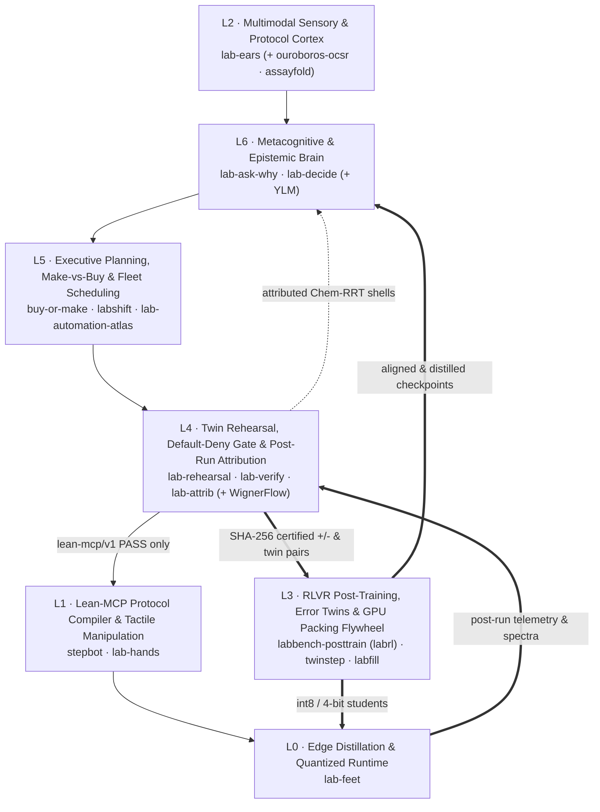

<p>
  <a href="https://antigravity.google/"></a>
  <sub>This project uses API credits from the Google Antigravity for Science program. Thank you, Google Antigravity!</sub>
</p>
<br clear="left">

<div align="center">
<picture>
  <source media="(prefers-color-scheme: dark)" srcset="assets/autolab_mark_dark.svg">
  
</picture>

# Auto-Lab

**A 7-layer embodied brain, default-deny safety nervous system, and verifiable RL post-training stack for autonomous wet laboratories.**

**Project Website & Interactive Lab:** [https://yaniguan.github.io/auto-lab/](https://yaniguan.github.io/auto-lab/) · [Lean 4 Trust Regime & Papers](https://yaniguan.github.io/auto-lab/trust/) · [Interactive Sandbox](https://yaniguan.github.io/auto-lab/studio/) · [15-Repo Cards](https://yaniguan.github.io/auto-lab/repos/)

[](https://yaniguan.github.io/auto-lab/)
[](LICENSE)
[](pyproject.toml)
[](https://github.com/yaniguan/auto-lab/actions/workflows/tests.yml)
[](#the-15-core-repositories)

</div>

## Why a Layered Brain & Nervous System?

Wiring a free-form language model directly to a liquid handler or robotic arm fails in real laboratories: uncalibrated models hallucinate reagent volumes, omit wash steps, reuse contaminated pipette tips, violate inter-step incubation windows, and game naive scalar RL rewards.

**Auto-Lab** decomposes an autonomous robot co-scientist into **seven explicit cognitive, executive, inhibitory, sensory, motor, edge, and post-training layers (`L6` → `L0`)** across **15 modular repositories** (plus 4 connected companion repositories for 3D equivariant reasoning, generative MD, chemical vision, and unified data ingestion):



## Quickstart

Clone the hub, install the zero-dependency `autolab` CLI, and pull or inspect all 15 sibling repositories:

```bash
git clone https://github.com/yaniguan/auto-lab.git && cd auto-lab
pip install -e ".[dev]"

# Clone or fetch all 15 Auto-Lab repositories into the parent workspace directory
python scripts/sync_all.py --action clone-or-fetch

# Inspect the 7-layer Brain -> Body hierarchy and per-repo dossiers
autolab layers
autolab list
autolab inspect lab-attrib
autolab inspect labbench-posttrain

# Run deterministic 7-layer closed-loop traces (GO vs L4 Block vs L6 Abstain vs lab-attrib Ghost-Peak Quarantine)
autolab loop --scenario serial_dilution
autolab loop --scenario broken_tip_reuse
autolab loop --scenario precursor_ghost_peak
autolab loop --scenario uncalibrated_molecule

# Run hub integrity & cross-repo lean-mcp/v1 wire tests (Lean and sibling checks skip with a reason
# when missing; AUTOLAB_REQUIRE_LEAN=1 or AUTOLAB_REQUIRE_SIBLINGS=1 turns those skips into failures)
pytest
```

## The 15 Core Repositories

Every repository documents **Object**, **Data**, **Model**, **Training**, **History**, and **Unique Properties** in both its `README.md` and `docs/ARCHITECTURE_AND_HISTORY.md` (see [`docs/REPO_MATRIX.md`](docs/REPO_MATRIX.md) and [`docs/ISSUES_AUDIT_INDEX.md`](docs/ISSUES_AUDIT_INDEX.md)):

| Layer | Repository | Anatomical / System Role | Key Measured Baseline / Invariant | Dossier & Tracker |
|---|---|---|---|---|
| **L6 Brain** | [`lab-ask-why`](https://github.com/yaniguan/lab-ask-why) | Socratic co-scientist for opposing claims | `0.909` SciFact dev `hit@3` (`0.876` set recall), `90.7%` conformal stance cov, `100%` ConflictBank | [Profile](https://github.com/yaniguan/lab-ask-why/blob/main/docs/ARCHITECTURE_AND_HISTORY.md) · [Issues](https://github.com/yaniguan/lab-ask-why/issues) |
| **L6 Brain** | [`lab-decide`](https://github.com/yaniguan/lab-decide) | Calibrated decision API & sequential BO | `92.4%` 20-seed ESOL `cov_in`, `11/11` informative real gates, `0.000` OOD BO picks (`0.10` Doyle regret) | [Profile](https://github.com/yaniguan/lab-decide/blob/main/docs/ARCHITECTURE_AND_HISTORY.md) · [Issues](https://github.com/yaniguan/lab-decide/issues) |
| **L5 Exec** | [`buy-or-make`](https://github.com/yaniguan/buy-or-make) | Make-vs-buy triage & `Retro*` synthesis | `69.2%` `Retro*` 5-step solve (`PaRoutes`/`SynPlanner`), `43.0%` USPTO-50K top-10, strict `null` prices | [Profile](https://github.com/yaniguan/buy-or-make/blob/main/docs/ARCHITECTURE_AND_HISTORY.md) · [Issues](https://github.com/yaniguan/buy-or-make/issues) |
| **L5 Exec** | [`labshift`](https://github.com/yaniguan/labshift) | Multi-instrument time-window scheduler | `CP-SAT` `30/30` v1 (`116.4m`) & `20/20 OPT` planted (vs `17/20` stdlib `LNS`, `7/20` repair, `0/20` greedy) | [Profile](https://github.com/yaniguan/labshift/blob/main/docs/ARCHITECTURE_AND_HISTORY.md) · [Issues](https://github.com/yaniguan/labshift/issues) |
| **L5 Exec** | [`lab-automation-atlas`](https://github.com/yaniguan/lab-automation-atlas) | Semantic map of platforms, DSLs & datasets | `84` typed entries across `7` categories, compound SPDX + DNS-pinned SSRF, `335` Lean `#eval` parity | [Profile](https://github.com/yaniguan/lab-automation-atlas/blob/main/docs/ARCHITECTURE_AND_HISTORY.md) · [Issues](https://github.com/yaniguan/lab-automation-atlas/issues) |
| **L4 Gate** | [`lab-rehearsal`](https://github.com/yaniguan/lab-rehearsal) | Episodic recall + 96-well twin dry-run | `6` fixtures (`5/5` fault classes blocked), non-capping wire + `from_stepbot` round-trip & Lean 4 parity | [Profile](https://github.com/yaniguan/lab-rehearsal/blob/main/docs/ARCHITECTURE_AND_HISTORY.md) · [Issues](https://github.com/yaniguan/lab-rehearsal/issues) |
| **L4 Gate** | [`lab-verify`](https://github.com/yaniguan/lab-verify) | Default-deny Lean / SQL / `Lean-MCP` gate | `22/22` lab SQL, `931/931` + `232/232` real MIMIC-IV `EHRSQL-2024`, Lean `#print axioms` & Ed25519 MCP | [Profile](https://github.com/yaniguan/lab-verify/blob/main/docs/ARCHITECTURE_AND_HISTORY.md) · [Issues](https://github.com/yaniguan/lab-verify/issues) |
| **L4 Gate** | [`lab-attrib`](https://github.com/yaniguan/lab-attrib) | Post-run blame, Voigt-NNLS & negative ledger | `30` Lean 4 theorems (`0 sorry`), `51` real spectra (`0.0%` A-Lab & Raman FDR, `82.4%` MassSpecGym Top-1) | [Profile](https://github.com/yaniguan/lab-attrib/blob/main/docs/ARCHITECTURE_AND_HISTORY.md) · [Paper](https://github.com/yaniguan/lab-attrib/blob/main/paper/main.pdf) |
| **L3 RLVR** | [`labbench-posttrain`](https://github.com/yaniguan/labbench-posttrain) | Scientist + Operator + `labrl` RLVR SDK | `49,139` records (`0` `cid|` fallback, `0` leak), `sequence_exact` Reverse-KL, pinned `RL` & Lean 4 CI | [Profile](https://github.com/yaniguan/labbench-posttrain/blob/main/docs/ARCHITECTURE_AND_HISTORY.md) · [Issues](https://github.com/yaniguan/labbench-posttrain/issues) |
| **L3 RLVR** | [`twinstep`](https://github.com/yaniguan/twinstep) | Seeded-error protocol twins & ordering DAGs | `24` split protocols (`81.3%` unseen test ED, `87.3%` balanced, `100%` DAG sat.) + `4` public corpora | [Profile](https://github.com/yaniguan/twinstep/blob/main/docs/ARCHITECTURE_AND_HISTORY.md) · [Issues](https://github.com/yaniguan/twinstep/issues) |
| **L3 RLVR** | [`labfill`](https://github.com/yaniguan/labfill) | Batched protocol checking & GPU packing | 120-bit checker (`<=10 L`), `308/310` live `LabLean` CI match, `O(N log N)` OBFD (`92.4%`–`98.8%` useful tok) | [Profile](https://github.com/yaniguan/labfill/blob/main/docs/ARCHITECTURE_AND_HISTORY.md) · [Issues](https://github.com/yaniguan/labfill/issues) |
| **L2 Ears** | [`lab-ears`](https://github.com/yaniguan/lab-ears) | BIOES span tagging & acoustic monitoring | `0.876` WLP `BIOES` micro-F1 (`0.875` SHA-unseen), matched 2s stream cal & fail-closed `[300,3400] Hz` privacy | [Profile](https://github.com/yaniguan/lab-ears/blob/main/docs/ARCHITECTURE_AND_HISTORY.md) · [Issues](https://github.com/yaniguan/lab-ears/issues) |
| **L1 Motor** | [`stepbot`](https://github.com/yaniguan/stepbot) | YAML/JSON → Opentrons Python API v2 compiler | `100.0%` `opentrons.simulate` `8.8.2` parity (`311/311` seeded + `36/36` public assays), 8-ch & rheology | [Profile](https://github.com/yaniguan/stepbot/blob/main/docs/ARCHITECTURE_AND_HISTORY.md) · [Issues](https://github.com/yaniguan/stepbot/issues) |
| **L1 Motor** | [`lab-hands`](https://github.com/yaniguan/lab-hands) | 6/7-DoF SE(3) planning, slosh & tactile insert | UR5e/Panda `Informed RRT*` + `TOPP-RA`, `EI` slosh (`10.2×` ringdown cut), `99.0%` active tactile (`495/500`) | [Profile](https://github.com/yaniguan/lab-hands/blob/main/docs/ARCHITECTURE_AND_HISTORY.md) · [Issues](https://github.com/yaniguan/lab-hands/issues) |
| **L0 Feet** | [`lab-feet`](https://github.com/yaniguan/lab-feet) | Edge distillation, ONNX/C99 & drift runtime | `WHT+GPTQ W4A8` `SpectralResNet1D` (`93.5%` MNIST-1D), ONNX `qlinear` (`>=99%` C99 parity), `TTN+CRC` drift | [Profile](https://github.com/yaniguan/lab-feet/blob/main/docs/ARCHITECTURE_AND_HISTORY.md) · [Issues](https://github.com/yaniguan/lab-feet/issues) |

### Connected Companion Organs in `@yaniguan`

| Layer | Companion Repo | Role in the Co-Scientist Organism |
|---|---|---|
| **L6 Brain** | [`YLM`](https://github.com/yaniguan/YLM) ([Studio](https://yaniguan.github.io/YLM/)) | SE(3)-equivariant 3D molecule + language reasoner (`0.960` force cosine across 32 rotations) & home of LabLean |
| **L4 Gate** | [`WignerFlow`](https://github.com/yaniguan/WignerFlow) ([Studio](https://yaniguan.github.io/WignerFlow/)) | 50-fs integrator-free equivariant MD & strict `[physics]` surrogate gate for `YLM` |
| **L2 Eyes** | [`ouroboros-ocsr`](https://github.com/yaniguan/ouroboros-ocsr) ([Studio](https://yaniguan.github.io/ouroboros-ocsr/)) | SE(2)-equivariant chemical structure recognition bridging 2D figures to 3D conformers |
| **L2 Data** | [`assayfold`](https://github.com/yaniguan/assayfold) | Unified SHA-256-sealed, UCUM-normalized, SPDX-license-gated schema across 27 open lab sources |

## Repository Layout

```text
auto-lab/
├── autolab/                      # Zero-dependency hub package & `autolab` CLI
│   ├── catalog.py                # Typed 7-layer registry & JSON catalog loaders
│   ├── datasets.py               # Fail-closed SHA-256-verified Delaney ESOL loader (no synthetic fallback)
│   ├── importers/
│   │   └── opentrons_runlog.py   # Fail-closed `opentrons.simulate` CPU runlog -> `REHEARSAL` importer
│   ├── loop_demo.py              # Deterministic L2 -> L6 -> L5 -> L4 -> L1 -> L0 -> L3 trace simulator
│   ├── trust_regime.py           # Runtime bridge to compiled `autolab-lean --batch-tsv`
│   ├── memory.py                 # 4-Layer 'Undergrad' Agent Memory + Bottom Reasoning Traces + Dreaming
│   └── cli.py                    # `autolab layers | list | inspect | loop | status | trust | memory`
├── catalog/
│   ├── repos.json                # Verified Object, Data, Model, Training, History, Properties for all 15 repos
│   ├── issues_index.json         # Structured index of all 461 deep audit issues & live URLs (458 closed, 3 PENDING_GPU)
│   └── workspace.manifest.json   # Git URLs, branches, HEAD SHAs, and sibling checkout layout
├── docs/
│   ├── BRAIN_HIERARCHY.md        # Architectural specification of Layers L6 -> L0
│   ├── POSTTRAIN_FLYWHEEL.md     # Execution-to-RLVR data & post-training flywheel
│   ├── REPO_MATRIX.md            # Side-by-side 15-repository dossier matrix
│   ├── TRUST_REGIME_STUDY.md     # Formal Lean 4 Trust Regime, real Opentrons audit & real-vs-simulated table
│   ├── NOVEL_DIRECTIONS_FROM_COMMUNITY.md # 4 next-gen directions synthesized from 2025-2026 discourse
│   ├── AGENT_MEMORY_ARCHITECTURE.md # 4-Layer Undergrad Memory, Bottom Reasoning Traces & Dreaming
│   └── ISSUES_AUDIT_INDEX.md     # Master index of all filed GitHub Issues across the audited repos
├── lean/                         # AutoLabLean Hub Kernel: Lean 4.36.0 (50 theorems, 27 #guard checks, 0 sorry)
│   ├── AutoLabLean/              # L6 -> L0 specs, bounded autonomy, frontiers & agent memory theorems
│   ├── Main.lean                 # Native `autolab-lean` showcase & `--batch-tsv` runtime verifier
│   └── lakefile.toml             # Zero-dependency Lake build configuration
├── paper/                        # Standalone arXiv Technical Preprint (LaTeX + Type-42 vector figures + compiled PDF)
│   ├── main.tex                  # Manuscript source
│   ├── autolab_preprint.sty      # Modern editorial preprint layout & Page-1 banner
│   ├── generate_figures.py       # Reproducible matplotlib vector PDF generator
│   └── main.pdf                  # Compiled 9-page preprint PDF (+ lab-attrib monograph in site/assets/)
├── benchmarks/
│   ├── real_protocol_rehearsal.py # Real public Opentrons Protocol Library rehearsal & 23-deny audit
│   ├── trust_regime_study.py     # Reproducible 5-task study via compiled `autolab-lean` + `stepbot`/`labshift`
│   ├── novel_directions_study.py # Evaluation of the 4 next-gen frontier directions
│   ├── agent_memory_study.py     # Rusty-SOP, novel-assay transfer & 60-session Dreaming memory study
│   ├── twenty_community_ideas_study.py # Unified harness running all 20 sub-repo `community_extensions/`
│   └── results/                  # Committed JSON metrics verified for zero drift against README in CI
├── scripts/
│   ├── sync_all.py               # Clone, fetch, or check git cleanliness across all 15 repos
│   └── build_site_data.py        # Compiles catalog/ and audit data into docs/ and site/assets/
├── site/                         # Multi-page GitHub Pages website
│   ├── index.html                # Overview, Monoline Robot Sketch & 19-Repo Topology
│   ├── trust/index.html          # Interactive Lean 4 Trust Regime & Empirical Lift Explorer
│   ├── studio/index.html         # Interactive Closed-Loop, Post-Train & Conformal Sandboxes
│   ├── repos/index.html          # Interactive 15-Repository Problem Stories & Live Examples
│   ├── audit/index.html          # Maintainer Issue Backlog Explorer
│   ├── shared.js                 # Shared theme persistence, data loader & SVG chart primitives
│   └── styles.css                # Clean daylight-first editorial stylesheet
└── tests/
    ├── test_autolab.py           # Pytest suite verifying Lean proofs, cross-repo lean-mcp/v1 parity, CLI, and site
    ├── test_opentrons_runlog.py  # Offline mock-runlog + live CPU `opentrons.simulate` importer tests
    └── test_benchmark_honesty.py # Enforces fail-closed loaders and zero drift between README & results/*.json
```

## Formal Trust Regime (`AutoLabLean`), Undergraduate Memory & Preprints

Every hard physical, statistical, stoichiometric, temporal, security, privacy, licensing, post-run attribution, and memory-hygiene guardrail across the 15 repositories is formalized centrally in [`lean/`](lean/) (`leanprover/lean4:v4.36.0`, **50 machine-checked theorems**, **27 `#guard` witnesses**, **0 `sorry`**), mirrored as standalone Lake packages (`<repo>/lean/`) across all 15 sub-repositories (**250+ sub-repo theorems**, including 30 in [`lab-attrib`](https://github.com/yaniguan/lab-attrib)), and documented in [`docs/TRUST_REGIME_STUDY.md`](docs/TRUST_REGIME_STUDY.md):

- **Real Held-Out Molecular Discovery (`1,128` SHA-256-verified Delaney ESOL compounds, `sibling:lab-decide/data/delaney-processed.csv`)**: With identical raw GBDT ranking across all arms (no OOD optimism bonus), held-out drug-like scaffold MAE drops **`1.462 -> 0.604`** log(mol/L) and empirical 90% split-conformal coverage rises **`50.4% -> 91.2%`**, while raw soluble fraction (`measured logS >= -2.8`) trades off `50.4% -> 32.2%` due to abstaining on heavy extrapolations (`0.0%` simulated procurement + kNN gate violations is **by construction**).
- **Real Public Opentrons Protocol Library Rehearsal (`85` pinned `.py`/`.json` protocols via `opentrons.simulate`)**: **`58/85` (`68.2%`)** real protocols import into `REHEARSAL` (`27/85` fail closed via `UnsupportedProtocolStepError`, `0` silent drops, `0` Lean-Python mismatches), yielding **`35` allowed** and **`23` denied**; manual code audit of all `23` denies finds **`12` (`52.2%`) true physical/calibration hazards** (e.g., `250 uL` in a `200 uL` well, `200 uL` in a `100 uL` PCR well, `1.0 uL` on a `P300` pipette) and a **`47.8%` (`11/23`) abstraction false-alarm rate** (undeclared pre-2.14 `load_liquid`, same-well pre-wet/`disposal_volume` return, `.top()` air-dispense).
- **Simulated Wet-Lab Protocol Synthesis (`200 x 8` candidates + independent `stepbot` simulator)**: On the 3-template x 7-fault synthetic generator, independent `stepbot` Opentrons API v2.16 simulator faults drop **`18.5% -> 0.0%`**, while Lean-certified completion rises from `22.0%` (top-1) / `28.0%` (bitmask heuristic) to **`87.0%`** (Best-of-8) and **`97.5%`** (with 1-step repair; `0.0%` Lean assay-rule violations is **by construction**).
- **Fleet Scheduling (`30` `labshift` synthetic instances)**: Comparing `labshift`'s `ungated_greedy`, `greedy_with_repair`, and OR-Tools `cpsat` solvers (fail-closed if `labshift` is missing), feasibility improves from `24/30` (`13` window violations) to **`30/30` (`0` violations)** with mean makespan **`129.8 -> 116.4 min`** (`-10.3%`; `cpsat` is OR-Tools CP-SAT tightened with `makespan_lower_bound`, not Lean runtime).
- **Adversarial SQL Suite (`lab-verify`) & 6-Arm Bandit Policy Simulation (`GPU RLVR PENDING`)**: On `30` hand-authored SQL queries sorted wrong-first (`18` wrong), false accepts drop **`55.6% -> 0.0%`** (`L1-L3` vs `L1-L4`). In a **6-arm bandit policy simulation (not LLM weight training; GPU RLVR run `PENDING`)**, verified arm probability mass rises **`0.4% -> 98.4%`** under multiplicative Lean reward gating.
- **Frontier Directions (`NovelDirections.lean`)**: (1) *Diagnostic Attribution* (`real_esol` + simulated separable fault telemetry) cuts FDR **`8.3% -> 0.0%`** (`52.2 -> 67.6` hits); (2) *Stepped `Chem-RRT` Frontier* (`real_esol`) unlocks **`30.8-54.4`** multi-ring scaffolds (vs `1.2` static; `0.0` uncalibrated leaps **by construction**); (3) *`Lean-MCP` 72h Clock Simulation* completes **`472` vs `88`** runs (`0` replays **by construction**); and (4) *Fixed Fault-Family Mutation Check* (**21 distinct cases**, 3 templates x 7 fault classes cycled to 140 draws; not an adaptive adversary) reduces fault evasion **`85.7% -> 57.1% -> 0.0%`** (**by construction**).

### What Is Real vs. Simulated

Every row below is verified automatically in `pytest` ([`tests/test_benchmark_honesty.py`](tests/test_benchmark_honesty.py)) against `benchmarks/results/*.json`:

| Headline Metric | Reported Value | Script | JSON Key | n | Input / Ground-Truth Basis |
| :--- | :--- | :--- | :--- | :--- | :--- |
| **ESOL Held-Out Lead Prediction MAE** | `1.462 -> 0.604` log(mol/L) | `benchmarks/trust_regime_study.py` | `trust_regime_results.json:experiments.exp1_molecular_discovery.regimes.ungated.prediction_mae -> trust_regime_results.json:experiments.exp1_molecular_discovery.regimes.lean_trust.prediction_mae` | `1,128` real ESOL (`25`/seed x `5` seeds) | `real_data` (`delaney-processed.csv`, SHA-256 verified; raw GBDT ranking) |
| **ESOL Empirical 90% Conformal Coverage** | `50.4% -> 91.2%` | `benchmarks/trust_regime_study.py` | `trust_regime_results.json:experiments.exp1_molecular_discovery.regimes.ungated.empirical_coverage_pct -> trust_regime_results.json:experiments.exp1_molecular_discovery.regimes.lean_trust.empirical_coverage_pct` | `1,128` real ESOL (`25`/seed x `5` seeds) | `real_data` (independent measured `logS`) |
| **ESOL Measured Soluble Hit Rate (`logS >= -2.8`)** | `50.4% -> 32.2%` | `benchmarks/trust_regime_study.py` | `trust_regime_results.json:experiments.exp1_molecular_discovery.regimes.ungated.measured_soluble_hit_pct -> trust_regime_results.json:experiments.exp1_molecular_discovery.regimes.lean_trust.measured_soluble_hit_pct` | `1,128` real ESOL (`25`/seed x `5` seeds) | `real_data` (independent measured `logS`, decoupled from gate verdict) |
| **ESOL Full-Pool In-Region vs OOD MAE** | `0.558 -> 1.368` log(mol/L) | `benchmarks/trust_regime_study.py` | `trust_regime_results.json:experiments.exp1_molecular_discovery.real_heldout_pool_diagnostic.in_region_mae -> trust_regime_results.json:experiments.exp1_molecular_discovery.real_heldout_pool_diagnostic.abstained_ood_mae` | `468` held-out/seed x `5` seeds | `real_data` (zero synthetic flags) |
| **Exp 1 Procurement + kNN Gate Rejections** | `89.6% -> 0.0%` | `benchmarks/trust_regime_study.py` | `trust_regime_results.json:experiments.exp1_molecular_discovery.regimes.ungated.gate_violation_pct_by_construction -> trust_regime_results.json:experiments.exp1_molecular_discovery.regimes.lean_trust.gate_violation_pct_by_construction` | `25`/seed x `5` seeds | `simulation` + `by_construction` (random procurement flags; gate invariant) |
| **Real Opentrons Library Import Coverage** | `58 / 85` (`68.2%`) | `benchmarks/real_protocol_rehearsal.py` | `opentrons_library_rehearsal.json:summary.n_imported -> opentrons_library_rehearsal.json:summary.n_total` | `85` public `.py`/`.json` protocols | `real_data` + `independent_simulator` (`opentrons.simulate` CPU; `27` fail-closed) |
| **Real Opentrons Allowed vs Denied Protocols** | `35` allowed / `23` denied | `benchmarks/real_protocol_rehearsal.py` | `opentrons_library_rehearsal.json:summary.n_allowed -> opentrons_library_rehearsal.json:summary.n_denied` | `58` imported real protocols | `real_data` (`autolab-lean --batch-tsv`; `0` mirror mismatches) |
| **Real Opentrons Deny False-Alarm Rate** | `47.8%` (`11` false alarms / `12` true hazards) | `benchmarks/real_protocol_rehearsal.py` | `opentrons_library_rehearsal.json:summary.audited_false_alarm_rate_pct -> opentrons_library_rehearsal.json:summary.audited_true_hazard_count` | `23 / 23` denied real protocols | `real_data` (manual code-grounded audit of all 23 denies) |
| **Exp 2 Independent `stepbot` Simulator Faults** | `18.5% -> 0.0%` | `benchmarks/trust_regime_study.py` | `trust_regime_results.json:experiments.exp2_protocol_synthesis.regimes.ungated_top1.independent_sim_fault_pct -> trust_regime_results.json:experiments.exp2_protocol_synthesis.regimes.lean_best_of_8_plus_guided_repair.independent_sim_fault_pct` | `200` tasks x `8` cands | `simulation` + `independent_simulator` (`stepbot` Opentrons API v2.16 check) |
| **Exp 2 Simulated Valid Completion (Bo8 + Repair)** | `22.0% -> 97.5%` | `benchmarks/trust_regime_study.py` | `trust_regime_results.json:experiments.exp2_protocol_synthesis.regimes.ungated_top1.valid_completion_pct -> trust_regime_results.json:experiments.exp2_protocol_synthesis.regimes.lean_best_of_8_plus_guided_repair.valid_completion_pct` | `200` tasks x `8` cands | `simulation` + `by_construction` (`0.0%` Lean rule violations by construction) |
| **Exp 3 Fleet Scheduling (`greedy` vs `cpsat`)** | `129.8 -> 116.4 min` (`24/30 -> 30/30`) | `benchmarks/trust_regime_study.py` | `trust_regime_results.json:experiments.exp3_fleet_scheduling.regimes.ungated_greedy.mean_makespan_min -> trust_regime_results.json:experiments.exp3_fleet_scheduling.regimes.cpsat.mean_makespan_min` | `30` `labshift` instances | `simulation` (synthetic benchmark suite; OR-Tools `cpsat` solver) |
| **Exp 4 Lab SQL Wrong-Query False Accepts** | `55.6% -> 0.0%` (`31.2% -> 75.0%` acc) | `benchmarks/trust_regime_study.py` | `trust_regime_results.json:experiments.exp4_sql_verification.regimes.syntax_readonly_schema_only_L1_L3.wrong_sql_false_accept_pct -> trust_regime_results.json:experiments.exp4_sql_verification.regimes.lean_4layer_default_deny_L1_L4.wrong_sql_false_accept_pct` | `16` pools / `30` queries (`18` wrong) | `simulation` (hand-authored wrong-first SQL stress suite) |
| **Exp 5 6-Arm Bandit Policy Simulation** | `0.4% -> 98.4%` verified arm mass | `benchmarks/trust_regime_study.py` | `trust_regime_results.json:experiments.exp5_rlvr_posttraining.regimes.soft_additive_reward_grpo.true_verified_accuracy_pct -> trust_regime_results.json:experiments.exp5_rlvr_posttraining.regimes.lean_trust_gated_grpo.true_verified_accuracy_pct` | `6` arms x `5` seeds x `160` steps | `simulation` / `PENDING` (6-logit softmax toy; neural GPU RLVR `PENDING`) |
| **Direction 1 Post-Run Attribution (`ATTRIB`)** | `8.3% -> 0.0%` FDR (`52.2 -> 67.6` hits) | `benchmarks/novel_directions_study.py` | `novel_directions_results.json:directions.d1_epistemic_attribution.comparison.naive_sdl.false_discovery_rate_pct -> novel_directions_results.json:directions.d1_epistemic_attribution.comparison.lean_attribution_sdl.false_discovery_rate_pct` | `1,128` ESOL (`96` assays x `5` seeds) | `real_data` + `simulation` (real ESOL + simulated separable fault telemetry) |
| **Direction 2 Stepped `Chem-RRT` Frontier** | `1.2 -> 30.8` (`54.4` undirected) scaffolds | `benchmarks/novel_directions_study.py` | `novel_directions_results.json:directions.d2_stepped_frontier.comparison.static_trust_wall_v1.certified_multiring_scaffolds_unlocked -> novel_directions_results.json:directions.d2_stepped_frontier.comparison.goal_directed_chem_rrt_shell.certified_multiring_scaffolds_unlocked` | `1,128` ESOL (`8` rounds x `5` seeds) | `real_data` + `by_construction` (real ESOL; `0.0` uncalibrated leaps by `FRONTIER`) |
| **Direction 3 `Lean-MCP` 72h Clock Simulation** | `88 -> 472` runs (`28 -> 0` replays) | `benchmarks/novel_directions_study.py` | `novel_directions_results.json:directions.d3_lean_mcp.comparison.per_run_human_approval_mcp.protocols_completed_in_72h -> novel_directions_results.json:directions.d3_lean_mcp.comparison.proof_carrying_lean_mcp.protocols_completed_in_72h` | `500` synthetic MCP calls | `simulation` + `by_construction` (72h discrete-event clock simulation) |
| **Direction 4 Fixed Fault-Family Mutation Check** | `85.7% -> 57.1% -> 0.0%` evasion | `benchmarks/novel_directions_study.py` | `novel_directions_results.json:directions.d4_adversarial_coevolution.generations.gen0_volume_bounds_only.saboteur_evasion_pct -> novel_directions_results.json:directions.d4_adversarial_coevolution.generations.gen2_autolablean_formal.saboteur_evasion_pct` | `21` distinct cases (`140` draws) | `simulation` + `by_construction` (fixed 3 x 7 fault grid; not adaptive) |

## Scientific Honesty & Status

- **CPU vs GPU**: Every benchmark reported in `auto-lab` and its 15 child repositories distinguishes completed CPU measurements (`labfill`, `labshift`, `twinstep`, `stepbot`, `buy-or-make`, `lab-ears`, `lab-decide`, `lab-verify`, `lab-rehearsal`, `lab-attrib`, `lab-hands`, `lab-feet`, and `labbench-posttrain` smoke runs) from full A100/H100 post-training campaigns, which remain explicitly marked `PENDING` until executed.
- **License Discipline**: Non-commercial benchmarks and datasets (`BioProBench`, `SciFact`, `TransCG`, `Touch-Slide`) and ShareAlike evaluation suites (`LAB-Bench` with canary strings) retain their upstream licenses and are never laundered into MIT/commercial exports.

## Citation

```bibtex
@misc{guan2026autolab,
  title  = {Auto-Lab: A Multi-Layer Embodied Brain, Default-Deny Safety Harness, and Verifiable Post-Training Stack for Autonomous Wet Laboratories},
  author = {Guan, Yani},
  year   = {2026},
  url    = {https://github.com/yaniguan/auto-lab},
  note   = {Project Studio: https://yaniguan.github.io/auto-lab/}
}
```

## License

Code and documentation in `auto-lab`: MIT ([LICENSE](LICENSE)). Linked datasets and upstream tools retain their own licenses.
