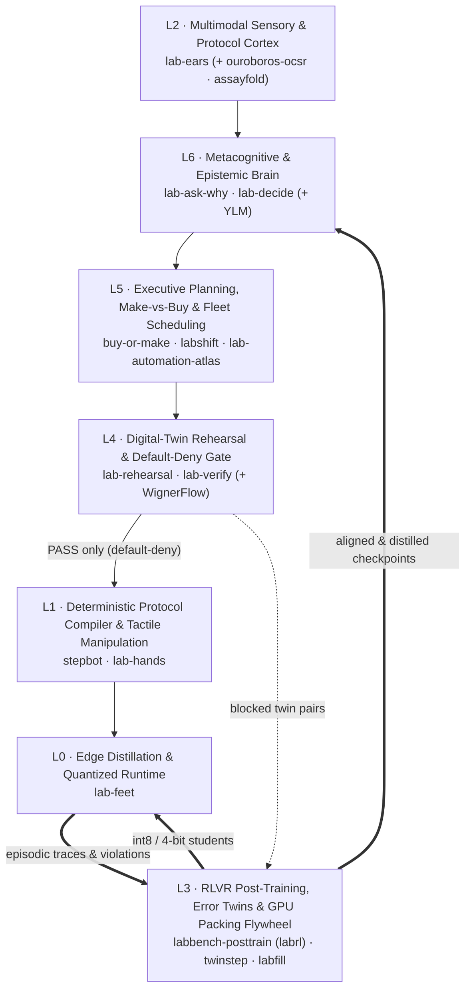

<p>
  <a href="https://antigravity.google/"></a>
  <sub>This project uses API credits from the Google Antigravity for Science program. Thank you, Google Antigravity!</sub>
</p>
<br clear="left">

<div align="center">
<picture>
  <source media="(prefers-color-scheme: dark)" srcset="assets/autolab_mark_dark.svg">
  
</picture>

# Auto-Lab

**A 7-layer embodied brain, default-deny safety nervous system, and verifiable RL post-training stack for autonomous wet laboratories.**

**Interactive Project Studio (EN / 中文):** [https://yaniguan.github.io/auto-lab/](https://yaniguan.github.io/auto-lab/)

[](https://yaniguan.github.io/auto-lab/)
[](LICENSE)
[](pyproject.toml)
[](https://github.com/yaniguan/auto-lab/actions/workflows/tests.yml)
[](#the-14-core-repositories)

</div>

## Why a Layered Brain & Nervous System?

Wiring a free-form language model directly to a liquid handler or robotic arm fails in real laboratories: uncalibrated models hallucinate reagent volumes, omit wash steps, reuse contaminated pipette tips, violate inter-step incubation windows, and game naive scalar RL rewards.

**Auto-Lab** decomposes an autonomous robot co-scientist into **seven explicit cognitive, executive, inhibitory, sensory, motor, edge, and post-training layers (`L6` → `L0`)** across **14 modular repositories** (plus 4 connected companion repositories for 3D equivariant reasoning, generative MD, chemical vision, and unified data ingestion):



## Quickstart

Clone the hub, install the zero-dependency `autolab` CLI, and pull or inspect all 14 sibling repositories:

```bash
git clone https://github.com/yaniguan/auto-lab.git && cd auto-lab
pip install -e ".[dev]"

# Clone or fetch all 14 Auto-Lab repositories into the parent workspace directory
python scripts/sync_all.py --action clone-or-fetch

# Inspect the 7-layer Brain -> Body hierarchy and per-repo dossiers
autolab layers
autolab list
autolab inspect labbench-posttrain

# Run deterministic 7-layer closed-loop traces (GO vs L4 Safety Block vs L6 Abstention)
autolab loop --scenario serial_dilution
autolab loop --scenario broken_tip_reuse
autolab loop --scenario uncalibrated_molecule

# Run hub integrity tests
pytest
```

## The 14 Core Repositories

Every repository documents **Object**, **Data**, **Model**, **Training**, **History**, and **Unique Properties** in both its `README.md` and `docs/ARCHITECTURE_AND_HISTORY.md`, and carries **≥20 code-grounded GitHub Issues** from line-by-line engineering inspection (see [`docs/REPO_MATRIX.md`](docs/REPO_MATRIX.md) and [`docs/ISSUES_AUDIT_INDEX.md`](docs/ISSUES_AUDIT_INDEX.md)):

| Layer | Repository | Anatomical / System Role | Key Measured Baseline / Invariant | Dossier & Tracker |
|---|---|---|---|---|
| **L6 Brain** | [`lab-ask-why`](https://github.com/yaniguan/lab-ask-why) | Socratic co-scientist for opposing claims | `0.789` BM25 rationale `recall@3` on SciFact dev (`SUPPORT` & `CONTRADICT`) | [Profile](https://github.com/yaniguan/lab-ask-why/blob/main/docs/ARCHITECTURE_AND_HISTORY.md) · [Issues](https://github.com/yaniguan/lab-ask-why/issues) |
| **L6 Brain** | [`lab-decide`](https://github.com/yaniguan/lab-decide) | Calibrated decision API with abstention | `92.2%` in-region split-conformal coverage (`MAE 0.656` vs `0.892` outside) on ESOL | [Profile](https://github.com/yaniguan/lab-decide/blob/main/docs/ARCHITECTURE_AND_HISTORY.md) · [Issues](https://github.com/yaniguan/lab-decide/issues) |
| **L5 Exec** | [`buy-or-make`](https://github.com/yaniguan/buy-or-make) | Make-vs-buy molecular triage & cost bounds | Strict `listed_catalog` USD/g leaf lower bounds (`null` when unlisted; `0.005 s/mol` cached) | [Profile](https://github.com/yaniguan/buy-or-make/blob/main/docs/ARCHITECTURE_AND_HISTORY.md) · [Issues](https://github.com/yaniguan/buy-or-make/issues) |
| **L5 Exec** | [`labshift`](https://github.com/yaniguan/labshift) | Multi-instrument time-window scheduler | OR-Tools `CP-SAT` `30/30` feasible (`116.7m` makespan) vs Greedy `24/30` (`13` window viol.) | [Profile](https://github.com/yaniguan/labshift/blob/main/docs/ARCHITECTURE_AND_HISTORY.md) · [Issues](https://github.com/yaniguan/labshift/issues) |
| **L5 Exec** | [`lab-automation-atlas`](https://github.com/yaniguan/lab-automation-atlas) | Semantic map of platforms, DSLs & datasets | Link-checked catalog of liquid handlers, cloud labs, protocol standards & open corpora | [Profile](https://github.com/yaniguan/lab-automation-atlas/blob/main/docs/ARCHITECTURE_AND_HISTORY.md) · [Issues](https://github.com/yaniguan/lab-automation-atlas/issues) |
| **L4 Gate** | [`lab-rehearsal`](https://github.com/yaniguan/lab-rehearsal) | Episodic recall + 96-well twin dry-run | `Recall → Rehearse → Verify → Run → Write-Back` (`runs.jsonl` blocks all 4 seeded fault classes) | [Profile](https://github.com/yaniguan/lab-rehearsal/blob/main/docs/ARCHITECTURE_AND_HISTORY.md) · [Issues](https://github.com/yaniguan/lab-rehearsal/issues) |
| **L4 Gate** | [`lab-verify`](https://github.com/yaniguan/lab-verify) | Default-deny Lean / SQL / protocol gate | 4-layer SQL gate (`parse → read-only → schema → execution`): `22/22` agreement, `0` false passes | [Profile](https://github.com/yaniguan/lab-verify/blob/main/docs/ARCHITECTURE_AND_HISTORY.md) · [Issues](https://github.com/yaniguan/lab-verify/issues) |
| **L3 RLVR** | [`labbench-posttrain`](https://github.com/yaniguan/labbench-posttrain) | Scientist + Operator + `labrl` RLVR SDK | `49,139` records (`0` group leak), `SFT → DPO/MPO/TROPD → PPO/GRPO/GDPO+DAPO`, 8 anti-hack templates | [Profile](https://github.com/yaniguan/labbench-posttrain/blob/main/docs/ARCHITECTURE_AND_HISTORY.md) · [Issues](https://github.com/yaniguan/labbench-posttrain/issues) |
| **L3 RLVR** | [`twinstep`](https://github.com/yaniguan/twinstep) | Seeded-error protocol twins & ordering DAGs | Deterministic 6-type error injection + topological dependency baseline (`100%` constraint sat.) | [Profile](https://github.com/yaniguan/twinstep/blob/main/docs/ARCHITECTURE_AND_HISTORY.md) · [Issues](https://github.com/yaniguan/twinstep/issues) |
| **L3 RLVR** | [`labfill`](https://github.com/yaniguan/labfill) | Batched protocol checking & GPU packing | Sequence packing + `bf16` hits `92.1%` useful tokens (`5.42×` CPU tok/s; `225.8k` proto/s check) | [Profile](https://github.com/yaniguan/labfill/blob/main/docs/ARCHITECTURE_AND_HISTORY.md) · [Issues](https://github.com/yaniguan/labfill/issues) |
| **L2 Ears** | [`lab-ears`](https://github.com/yaniguan/lab-ears) | Protocol span parsing & acoustic monitoring | `F1 0.75–0.91` on WLP slots + DCASE 2023 machine anomaly baseline (`300–3400 Hz` speech drop) | [Profile](https://github.com/yaniguan/lab-ears/blob/main/docs/ARCHITECTURE_AND_HISTORY.md) · [Issues](https://github.com/yaniguan/lab-ears/issues) |
| **L1 Motor** | [`stepbot`](https://github.com/yaniguan/stepbot) | YAML/JSON → Opentrons Python API v2 compiler | Deterministic `apiLevel 2.16` codegen + compile-time volume/tip checks + dual simulator | [Profile](https://github.com/yaniguan/stepbot/blob/main/docs/ARCHITECTURE_AND_HISTORY.md) · [Issues](https://github.com/yaniguan/stepbot/issues) |
| **L1 Motor** | [`lab-hands`](https://github.com/yaniguan/lab-hands) | Bench manipulation, RRT & last-cm touch | `100/100` collision-free SBS 96-well RRT + path shortcutting (`70.6 ms` mean CPU) | [Profile](https://github.com/yaniguan/lab-hands/blob/main/docs/ARCHITECTURE_AND_HISTORY.md) · [Issues](https://github.com/yaniguan/lab-hands/issues) |
| **L0 Feet** | [`lab-feet`](https://github.com/yaniguan/lab-feet) | Edge distillation & `int8` / `4-bit` runtime | `35×` parameter reduction (`85k → 2.4k`), `int8` (`0.0%` acc loss) & `4-bit` (`3.86 µs` CPU) | [Profile](https://github.com/yaniguan/lab-feet/blob/main/docs/ARCHITECTURE_AND_HISTORY.md) · [Issues](https://github.com/yaniguan/lab-feet/issues) |

### Connected Companion Organs in `@yaniguan`

| Layer | Companion Repo | Role in the Co-Scientist Organism |
|---|---|---|
| **L6 Brain** | [`YLM`](https://github.com/yaniguan/YLM) ([Studio](https://yaniguan.github.io/YLM/)) | SE(3)-equivariant 3D molecule + language reasoner (`0.960` force cosine across 32 rotations) & home of LabLean |
| **L4 Gate** | [`WignerFlow`](https://github.com/yaniguan/WignerFlow) ([Studio](https://yaniguan.github.io/WignerFlow/)) | 50-fs integrator-free equivariant MD & strict `[physics]` surrogate gate for `YLM` |
| **L2 Eyes** | [`ouroboros-ocsr`](https://github.com/yaniguan/ouroboros-ocsr) ([Studio](https://yaniguan.github.io/ouroboros-ocsr/)) | SE(2)-equivariant chemical structure recognition bridging 2D figures to 3D conformers |
| **L2 Data** | [`assayfold`](https://github.com/yaniguan/assayfold) | Unified SHA-256-sealed, UCUM-normalized, SPDX-license-gated schema across 12 open lab datasets |

## Repository Layout

```text
auto-lab/
├── autolab/                      # Zero-dependency hub package & `autolab` CLI
│   ├── catalog.py                # Typed 7-layer registry & JSON catalog loaders
│   ├── loop_demo.py              # Deterministic L2 -> L6 -> L5 -> L4 -> L1 -> L0 -> L3 trace simulator
│   └── cli.py                    # `autolab layers | list | inspect | loop | status`
├── catalog/
│   ├── repos.json                # Verified Object, Data, Model, Training, History, Properties for all 14 repos
│   ├── issues_index.json         # Structured index of all 300+ deep audit issues & live URLs
│   └── workspace.manifest.json   # Git URLs, branches, HEAD SHAs, and sibling checkout layout
├── docs/
│   ├── BRAIN_HIERARCHY.md        # Architectural specification of Layers L6 -> L0
│   ├── POSTTRAIN_FLYWHEEL.md     # Execution-to-RLVR data & post-training flywheel
│   ├── REPO_MATRIX.md            # Side-by-side 14-repository dossier matrix
│   └── ISSUES_AUDIT_INDEX.md     # Master index of all filed GitHub Issues across the 14 repos
├── scripts/
│   ├── sync_all.py               # Clone, fetch, or check git cleanliness across all 14 repos
│   └── build_site_data.py        # Compiles catalog/ and audit data into docs/ and site/assets/
├── site/                         # Interactive GitHub Pages Studio (Light/Dark + EN/中文)
│   ├── index.html                # 7-Layer Studio UI
│   ├── brain_cinema.js           # 60-s animated Brain & Nervous System HTML5 Canvas Cinema
│   ├── charts.js                 # Native SVG conformal, GPU packing, and CP-SAT Gantt charts
│   ├── app.js                    # Organ Inspector, 3 Sandboxes, 14-Repo Matrix, Issues Explorer
│   └── styles.css                # Clean daylight-first research stylesheet
└── tests/
    └── test_autolab.py           # Pytest suite verifying layers, closed-loop gating, CLI, and catalog
```

## Scientific Honesty & Status

- **CPU vs GPU**: Every benchmark reported in `auto-lab` and its 14 child repositories distinguishes completed CPU measurements (`labfill`, `labshift`, `twinstep`, `stepbot`, `buy-or-make`, `lab-ears`, `lab-decide`, `lab-verify`, `lab-rehearsal`, `lab-hands`, `lab-feet`, and `labbench-posttrain` smoke runs) from full A100/H100 post-training campaigns, which remain explicitly marked `PENDING` until executed.
- **License Discipline**: Non-commercial benchmarks and datasets (`BioProBench`, `SciFact`, `TransCG`, `Touch-Slide`) and ShareAlike evaluation suites (`LAB-Bench` with canary strings) retain their upstream licenses and are never laundered into MIT/commercial exports.

## Citation

```bibtex
@misc{guan2026autolab,
  title  = {Auto-Lab: A Multi-Layer Embodied Brain, Default-Deny Safety Harness, and Verifiable Post-Training Stack for Autonomous Wet Laboratories},
  author = {Guan, Yani},
  year   = {2026},
  url    = {https://github.com/yaniguan/auto-lab},
  note   = {Project Studio: https://yaniguan.github.io/auto-lab/}
}
```

## License

Code and documentation in `auto-lab`: MIT ([LICENSE](LICENSE)). Linked datasets and upstream tools retain their own licenses.
