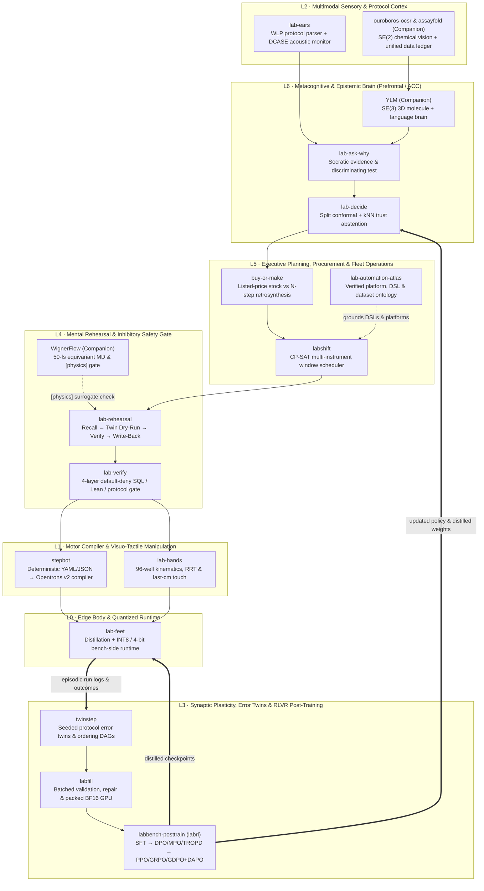

# The 7-Layer Embodied Co-Scientist Brain & Nervous System

`auto-lab` organizes **14 core infrastructure and post-training repositories** (together with **4 connected companion repositories**: [`YLM`](https://github.com/yaniguan/YLM), [`WignerFlow`](https://github.com/yaniguan/WignerFlow), [`ouroboros-ocsr`](https://github.com/yaniguan/ouroboros-ocsr), and [`assayfold`](https://github.com/yaniguan/assayfold)) into an explicit **7-layer neuro-embodied hierarchy (`L6` down to `L0`)**.

Instead of wiring an unconstrained language model directly to a liquid handler or robotic arm, every scientific goal passes downward through calibrated epistemic reasoning, resource triage, multi-instrument scheduling, digital-twin rehearsal, and mechanical default-deny verification before compiled commands reach physical actuators—and every outcome writes back upward into the post-training flywheel.

## Layer-by-Layer Contract Summary

| Layer | Biological Analogy | Core Repositories | Primary Invariant / Guarantee |
|---|---|---|---|
| **L6** | Prefrontal & Anterior Cingulate Cortex | `lab-ask-why`, `lab-decide` *(+ `YLM`)* | Never picks an ungrounded winner; surfaces opposing rationales and abstains outside calibrated kNN conformal trust bounds. |
| **L5** | Dorsolateral Prefrontal & Basal Ganglia | `buy-or-make`, `labshift`, `lab-automation-atlas` | Never invents catalog prices (`null` when unlisted); enforces `min_wait`/`max_wait` and pool capacity via exact sweep-line & CP-SAT. |
| **L4** | Premotor Twin & Basal Ganglia Inhibition | `lab-rehearsal`, `lab-verify` *(+ `WignerFlow`)* | **Default deny**: zero commands reach the robot unless episodic recall, digital-twin volume/tip simulation, and execution-level checks pass. |
| **L3** | Hippocampal Replay & Cerebellar Plasticity | `labbench-posttrain`, `twinstep`, `labfill` | Cryptographic `SplitGuard` (0 group leakage; `LAB-Bench` eval-only), anti-hack reward composers, and packed `bf16` high-useful-token training. |
| **L2** | Auditory, Language & Visual Sensory Cortex | `lab-ears` *(+ `ouroboros-ocsr`, `assayfold`)* | Parses structured protocol quantities (`Amount`, `Temp`, `Time`, `Speed`) and drops speech frequencies (`300–3400 Hz`) by default on audio monitors. |
| **L1** | Primary Motor & Somatosensory Cortex | `stepbot`, `lab-hands` | Deterministic `apiLevel 2.16` Opentrons Python codegen with compile-time well-volume bounds, plus obstacle-free RRT paths and tactile alignment. |
| **L0** | Spinal Cord & Peripheral Edge Compute | `lab-feet` | Compresses policies via logit distillation and `int8` / `4-bit` weight packing for low-latency CPU/NPU execution next to the bench. |
